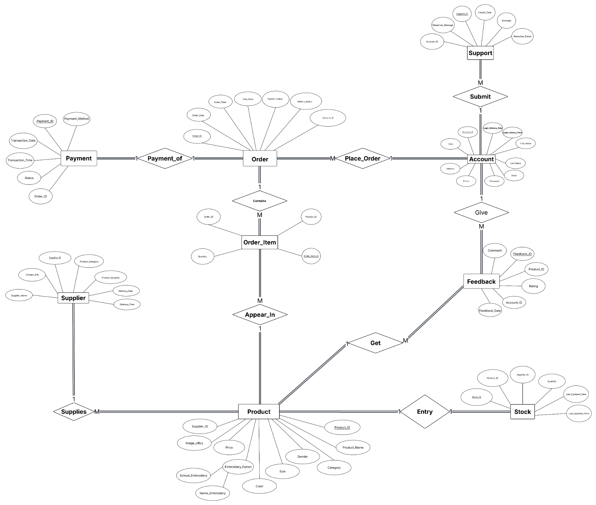

# Student Uniform E-Commerce Database Design

Academic team project for Database Systems and Applications. We designed a relational model for an online school uniform store. The deliverables were an entity–relationship diagram (ERD) and schema documentation. The database was not implemented or deployed.

## Store workflow

The proposed website serves parents and students from elementary through high school. Customers browse uniforms by attributes such as size, color, and category, choose embroidery options, and place orders. The model also supports recording payments, tracking delivery status, collecting reviews, and handling support requests.

Warehouse staff use stock records to track quantities, suppliers provide uniforms, and administrators maintain the catalog and respond to inquiries. Business managers oversee store operations.

## Entity–relationship diagram

## What each entity records

| Entity | Purpose |
|---|---|
| `Account` | Identifies users and records their roles and contact information. |
| `Product` | Describes a uniform, including price, size, color, and embroidery options. |
| `Supplier` | Identifies who supplies the uniforms and records delivery details. |
| `Stock` | Tracks product quantity and when it was last updated. |
| `Order` | Records the customer, order date, total, and payment and delivery status. |
| `Order_Item` | Links an order to a product and records the quantity purchased. |
| `Payment` | Records the payment method, transaction time, and status for an order. |
| `Feedback` | Links a customer's rating and comment to a product. |
| `Support` | Records a customer's inquiry, response status, and reply. |

## How the relationships work

- **Ordering:** One account can place several orders. Each order can contain several line items, and the same product can appear in many orders. For example, two shirts and one skirt can be recorded as two line items under the same order, each with its own quantity.
- **Payments and inventory:** The original diagram models order to payment and product to stock as one-to-one. A supplier can supply many products. Multiple payment attempts and inventory across multiple locations were outside the project scope.
- **Customer interactions:** An account can submit multiple support inquiries and leave multiple reviews. Each review is also linked to the product it describes.

## Normalization review

The team reviewed the design against first, second, and third normal forms, considering whether fields hold single values and whether non-key attributes depend on the right keys. Keeping line items separate from the order header avoids storing a list of products in one order field or repeating order-level details on every line item.

**Credit:** Based on the original Database Systems and Applications team project.
