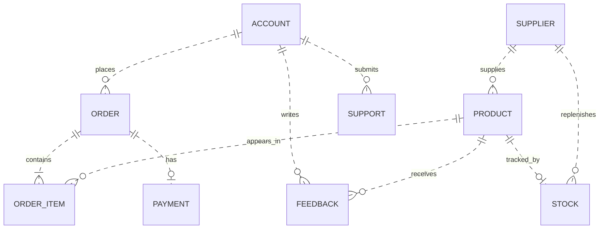

# Student Uniform E-Commerce Database Design

Academic team project for Database Systems and Applications. We designed a relational model for an online school uniform store. The deliverables were an entity–relationship diagram (ERD) and schema documentation. The database was not implemented or deployed.

## Entity–relationship diagram

`ORDER_ITEM` links orders and products. Each line item records the quantity of a product in an order. The portfolio diagram assumes an order may be awaiting payment and a product may not yet have a stock record. Multiple payment attempts and inventory across multiple locations are outside the project scope.

**Credit:** Based on the original Database Systems and Applications team project.
